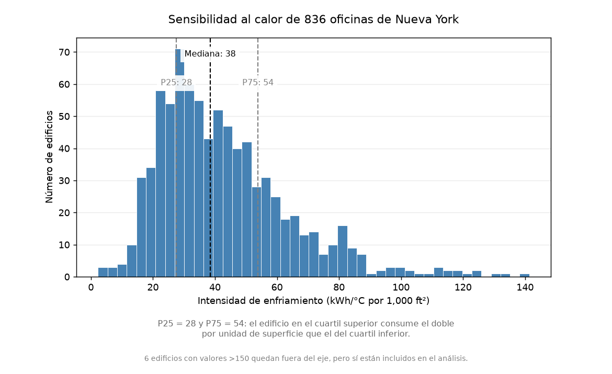
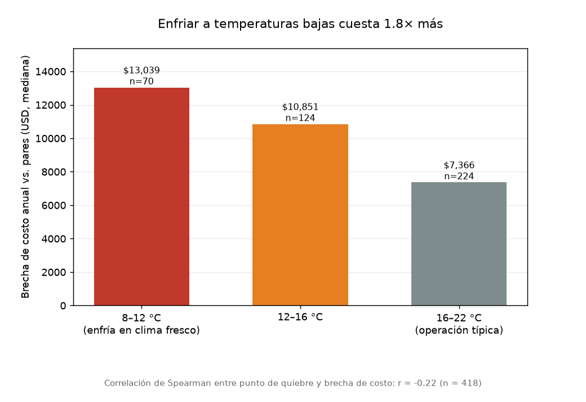
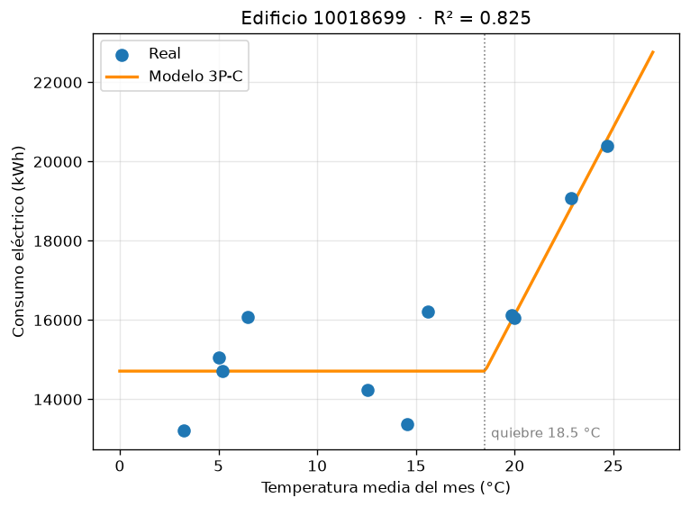

# How much extra do New York offices spend on cooling?

**Climate sensitivity of 836 NYC office buildings using the ASHRAE Guideline 14 three-parameter cooling model (3P-C).**

🔗 **Interactive case study:** https://robertoconstenla.netlify.app/proyectos/nyc-energia/

I combined public monthly electricity data (NYC Local Law 84) with 2023 historical temperatures and fitted a change-point cooling model to every office building. The result is a measure of how heat-sensitive each building is compared with similar-size peers, and what that difference costs per year.



## Key findings

| | Finding |
|---|---|
| **~2×** | Comparable buildings respond very differently to the same heat: the top-quartile building (P75 = 54 kWh/°C per 1,000 ft²) has about twice the cooling intensity of the bottom quartile (P25 = 28). |
| **+37%** | A building at the 75th percentile uses 37% more cooling per unit area than the median of its size group. |
| **1.8×** | Buildings that start cooling in mild weather (8–12 °C breakpoint) have a median annual cost gap 1.8× larger than those cooling from 16–22 °C (Spearman r = −0.22, n = 418). |
| **~$8.2M/yr** | Total annual gap of the 418 buildings above their peer median (median ≈ $9,200 per building). The top 10% of them account for about half of it. |



## Data

Three public sources, pulled through their APIs:

| Source | Content |
|---|---|
| [NYC LL84 monthly data](https://data.cityofnewyork.us/resource/fvp3-gcb2.json) | Electricity, gas and fuel oil use per building and month |
| [NYC LL84 annual data](https://data.cityofnewyork.us/resource/5zyy-y8am.json) | Floor area, year built, property uses, district steam |
| [Open-Meteo archive](https://open-meteo.com/) | Daily mean temperature for Central Park, 2023, averaged by month |

**From 2,403 reports to 836 buildings.** Every filter has a technical reason:

| Step | Buildings |
|---|---:|
| Offices ≥ 25,000 ft² reporting for 2023 | 2,403 |
| Duplicate reports removed | 2,345 |
| Valid electricity data | 2,038 |
| Non-electric heating source (gas, fuel oil or steam) | 1,833 |
| Valid 3P-C fit (R² ≥ 0.7, plausible breakpoint and slope) | 1,160 |
| ≥ 90% of floor area is office | **836** |

## Method

The 3P-C model separates a building's weather-independent load from its cooling load:

```
kWh_month = base + slope × max(0, temp_month − breakpoint)
```

| Parameter | Physical meaning |
|---|---|
| `base` | Load that does not depend on weather: lighting, elevators, plug loads |
| `breakpoint` | Outdoor temperature at which the building starts cooling |
| `slope` | Extra kWh per month for each °C above the breakpoint |



1. Fit the model to each building with a grid search over the breakpoint and linear regression for base and slope.
2. Normalize the slope by floor area (kWh/°C per 1,000 ft²) to get **cooling intensity**.
3. Compare each building against the median of its size group (25–50k, 50–100k, 100–250k, >250k ft²), since large buildings have economies of scale.
4. Convert the intensity gap to kWh with each building's cooling degree-days, then to dollars at $0.24/kWh.

## Decisions and limitations

- **Electric heating excluded.** The model assumes the electric meter does not include heating. I checked gas, four fuel-oil types and district steam for every building; 205 with no declared heating source were dropped.
- **Mixed-use correction.** Auditing the building with the largest gap showed it combined office, a K-12 school and a house of worship, while normalization used office area only. 324 of 1,160 buildings were under 90% office; the sample was restricted to ≥ 90% office use.
- **Dollar figures are a gap versus peers, not guaranteed savings.** $0.24/kWh is representative of NYC commercial rates.
- **One year of monthly data** (12 points per building). Results describe 2023 only.

## What it means in practice

A low breakpoint with a strong weather correlation usually points to control issues rather than equipment, which are often cheap to fix: miscalibrated economizers, fixed supply-air temperature with no reset strategy, and simultaneous cooling and reheat at terminal units.

## Repository contents

```
analisis_oficinas_nyc.ipynb   Full analysis, from API download to figures (in Spanish)
datos/
  panel_oficinas_2023.csv     Monthly electricity + temperature panel, all modelable offices
  panel_final.csv             Panel used for model fitting
  resultados_1160_edificios.csv  3P-C fits before the mixed-use correction
  resultados_836_edificios.csv   Final results, one row per building
figuras/                      Charts used in this README
```

## How to run it

```bash
pip install -r requirements.txt
jupyter notebook analisis_oficinas_nyc.ipynb
```

The notebook downloads the data from the public APIs, so no API key is needed.

## About me

Mechanical engineer with 15+ years in MEP, HVAC and fire protection design, now working in data analysis (IBM Data Analyst Professional Certificate). This project uses that domain knowledge to read public energy data the way an HVAC engineer would.

---

### Resumen en español

Análisis de 836 edificios de oficinas de Nueva York con datos públicos de consumo eléctrico (Local Law 84) y temperaturas de 2023, aplicando el modelo de enfriamiento de tres parámetros (3P-C) de ASHRAE Guideline 14. Entre edificios comparables, el cuartil superior tiene el doble de intensidad de enfriamiento que el inferior, y los edificios que empiezan a enfriar con clima fresco tienen una brecha de costo 1.8× mayor. El notebook completo está en español.
